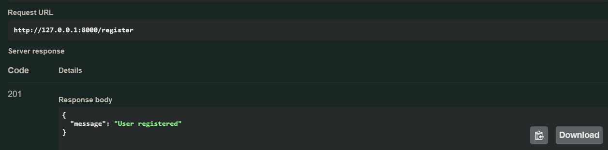
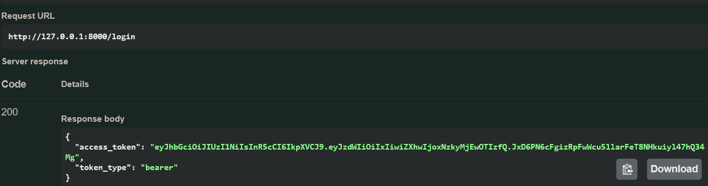
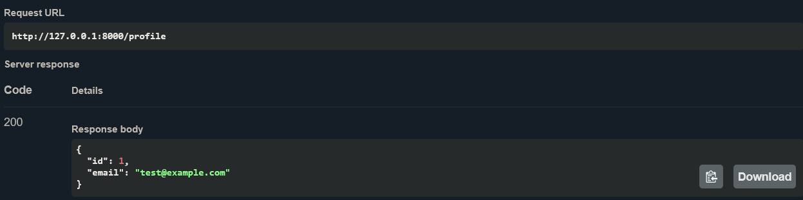

# Secure User Authentication

FastAPI + SQLite. Passwords are hashed with bcrypt, and JWT tokens protect routes.

## Setup
```bash
python -m venv venv
venv\Scripts\activate
pip install -r requirements.txt
uvicorn main:app --reload
```
Open http://127.0.0.1:8000/docs to test the API.

## Endpoints
| Method | Route | Auth | Description |
|---|---|---|---|
| POST | /register | No | Create an account (201, or 409 if the email exists) |
| POST | /login | No | Returns a JWT access token |
| GET | /profile | Yes | Returns the logged-in user |

## Example requests
Register:
```bash
curl -X POST http://127.0.0.1:8000/register -H "Content-Type: application/json" -d "{\"email\":\"test@example.com\",\"password\":\"mypassword123\"}"
```
Authenticated request:
```bash
curl http://127.0.0.1:8000/profile -H "Authorization: Bearer YOUR_TOKEN"
```

## Security
- Passwords are stored only as bcrypt hashes
- Tokens expire after 1 hour
- Input validation (valid email, password of at least 8 characters)
- Status codes: 201, 401, 409, 422

## Screenshots


